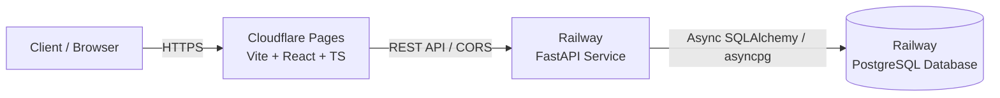

# NSAIPETROSOFT

Full-stack application architecture configured for **Cloudflare Pages** (Frontend) and **Railway** (FastAPI Backend + PostgreSQL Database).

---

## 🏗️ Architecture Overview



| Component | Technology | Hosting Platform | Key Configuration |
| :--- | :--- | :--- | :--- |
| **Frontend** | React 19, TypeScript, Vite | [Cloudflare Pages](https://pages.cloudflare.com) | Root: `frontend`, Output: `dist` |
| **Backend** | FastAPI, Python 3.12, Uvicorn | [Railway](https://railway.com) | Root: `backend`, Dockerfile / Procfile |
| **Database** | PostgreSQL | [Railway](https://railway.com) | Managed PostgreSQL Plugin |

---

## 📂 Project Structure

```
NSAIPETROSOFT/
├── frontend/                     # React + Vite + TypeScript (Cloudflare Pages)
│   ├── public/
│   │   └── _redirects            # Cloudflare Pages SPA rewrite rule
│   ├── src/
│   │   ├── api/client.ts         # Typed API client connected to backend
│   │   ├── App.tsx               # Interactive status and database dashboard
│   │   └── main.tsx              # React entry point
│   ├── .env.example              # Frontend environment variables template
│   ├── package.json
│   └── vite.config.ts
│
├── backend/                      # FastAPI + PostgreSQL (Railway)
│   ├── app/
│   │   ├── api/v1/endpoints/     # REST endpoints (/health, /items)
│   │   ├── core/config.py        # Settings with Railway DATABASE_URL translation
│   │   ├── db/session.py         # Async SQLAlchemy engine and session
│   │   ├── models/item.py        # PostgreSQL table models
│   │   ├── schemas/item.py       # Pydantic validation schemas
│   │   └── main.py               # FastAPI app, CORS middleware & lifespan
│   ├── Dockerfile                # Production container for Railway
│   ├── railway.json              # Railway deployment and healthcheck config
│   ├── Procfile                  # Alternative Procfile runner
│   ├── requirements.txt          # Python dependencies
│   └── .env.example              # Backend environment variables template
│
└── README.md
```

---

## 🚀 Deployment Instructions

### 1. Backend & Database Deployment on Railway

1. **Create a Railway Project**:
   - Go to [railway.com](https://railway.com) and create a **New Project**.
2. **Add PostgreSQL**:
   - Click **+ New** -> **Database** -> **Add PostgreSQL**.
3. **Add FastAPI Service from GitHub**:
   - Click **+ New** -> **GitHub Repo** -> select `NSAIPETROSOFT`.
   - Go to **Settings**:
     - **Root Directory**: `backend`
     - **Builder**: `Dockerfile` (or auto-detect)
4. **Connect PostgreSQL to FastAPI**:
   - Go to **Variables** tab in your FastAPI service.
   - Click **Add Reference** -> select `Postgres` -> `DATABASE_URL`.
   - Add `ENVIRONMENT`: `production`
   - Add `CORS_ORIGINS`: `https://<your-project>.pages.dev` (or comma-separated domains).
5. **Generate Public Domain**:
   - Go to **Networking** -> click **Generate Domain** (e.g. `https://nsaipetrosoft-api.up.railway.app`).
   - Test by opening `https://<your-domain>.up.railway.app/health`.

---

### 2. Frontend Deployment on Cloudflare Pages

1. **Connect GitHub to Cloudflare Pages**:
   - In Cloudflare Dashboard, navigate to **Workers & Pages** -> **Create application** -> **Pages** -> **Connect to Git**.
   - Select your `NSAIPETROSOFT` repository.
2. **Build Settings**:
   - **Framework preset**: `Vite`
   - **Root directory**: `frontend`
   - **Build command**: `npm run build`
   - **Build output directory**: `dist`
3. **Environment Variables**:
   - Add variable:
     - `VITE_API_BASE_URL` = `https://<your-railway-domain>.up.railway.app`
4. **Deploy**:
   - Click **Save and Deploy**.
   - Cloudflare Pages will build the app and deploy it with global CDN caching and automatic HTTPS.

---

## 💻 Local Development Setup

### Running the Backend

```bash
cd backend
python -m venv .venv

# Activate virtual environment
# Windows:
.venv\Scripts\activate
# macOS/Linux:
source .venv/bin/activate

# Install dependencies
pip install -r requirements.txt

# Start backend
uvicorn app.main:app --reload --port 8000
```
API Documentation will be available at [http://localhost:8000/docs](http://localhost:8000/docs).

### Running the Frontend

```bash
cd frontend
npm install
npm run dev
```
Open [http://localhost:5173](http://localhost:5173) in your browser.
