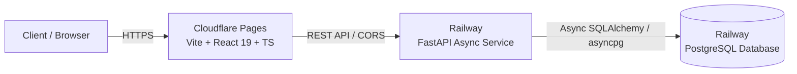

# NSAIPETROSOFT — Cloud Petrol Pump ERP & Fuel Management System

A high-performance, enterprise-grade Petrol Pump Management ERP cloned and reverse-engineered from industry-standard retail fuel station automation software. Designed for retail petroleum dealers (IOCL, BPCL, HPCL, Nayara, Reliance) with real-time nozzle totalizer meter tracking, underground dip variance calculations, fleet credit billing, cashier denomination settlement, tanker decanting purchase entry, and statutory compliance reporting.

---

## 🏗️ Architecture Overview



| Component | Technology | Hosting Platform | Production URL |
| :--- | :--- | :--- | :--- |
| **Frontend** | React 19, TypeScript, Vite, Glassmorphic CSS | [Cloudflare Pages](https://pages.cloudflare.com) | [`https://nsaipetrosoft.pages.dev`](https://nsaipetrosoft.pages.dev) |
| **Backend** | FastAPI (Python 3.12), Uvicorn Async | [Railway](https://railway.com) | `https://nsaipetrosoft-production.up.railway.app` |
| **Database** | PostgreSQL + asyncpg (16 Relational Tables) | [Railway](https://railway.com) | Managed Railway PostgreSQL |

---

## ⛽ Implemented Modules & Features

### 1. Executive Owner Dashboard (Frame 15 & 400)
- **Real-time KPI Tiles**: Today's Gross Sale (₹), Customer Credit Outstanding (₹), Net Bank/Cash Balance (₹), Underground Stock Asset Valuation (₹).
- **Payment Collection Breakdown**: Visual split across Physical Cash, Fleet Credit, and Digital Payments (PayTM, UPI, POS cards, PetroCard).
- **Underground Storage Tank Gauging**: Real-time capacity vs. current stock progress bars with dip levels (cm) for MS (Motor Spirit/Petrol) and HSD (High-Speed Diesel) with low-stock warnings.
- **Credit Fleet Outstanding Table**: Top debtor accounts with credit limits, unbilled balances, and instant WhatsApp reminder triggers.
- **Bank & POS Ledgers**: Live account balances for Current Accounts, Savings, POS Terminals, and Cash On Hand.

### 2. Daily Rate Master (Frame 85 & 100)
- Dynamic fuel rate revision with effective timestamping.
- Auto-lookup for state VAT rates (e.g. 14.9% HSD, 13.7% MS) and state CESS.
- Historical rate audit trail logging previous price fluctuations.

### 3. Shift Sales Entry & Nozzle Meter Totalizers (Frame 110 & 130)
- Multi-nozzle grid layout (HSD 1–4, MS 1–2).
- Automatic calculation of Net Sale Liters: `Sale Qty = (Closing Meter - Opening Meter) - Testing Liters`.
- Totalizer value calculation with real-time amount computation.
- Keyboard shortcuts: `F1` for Shift Sales, `F2` for Rate Master, `F3` for Credit Billing, `ESC` to dismiss.

### 4. Credit Fleet Customer Sales & Vehicle Slips (Frame 45 & 70)
- Vehicle-wise slip entry (Vehicle Number, Indent/Slip No, Driver Name, Quantity, Rate).
- Spot Cash Advance deduction: `Net Credit Amount = (Qty × Rate) - Cash Advance`.
- Credit limit validation against customer ledger.
- Instant WhatsApp format generator for paperless driver acknowledgment.

### 5. Cashier Denomination Settlement & Cash Gap Engine (Frame 200 & 220)
- Currency denomination tally sheet (`₹2000`, `₹500`, `₹200`, `₹100`, `₹50`, `₹20`, `₹10`, `₹5`, `Coins`).
- Cashier reconciliation math:
  - `Expected Cash = Total Meter Sales - Fleet Credit Sales - Digital/POS Receipts - Shift Expenses + Credit Collections`
  - `Gap Amount = Physical Cash Handover - Expected Cash`
  - Automatic classification: `BALANCED`, `SHORTAGE (Cashier Owes)`, or `EXCESS`.

### 6. Underground Tank Dip Register & Evaporation Loss Audit (Frame 260 & 280)
- Physical dip measurement (cm) translated to calibrated volume in Liters.
- Statutory daily variation audit:
  - `Dip-Wise Sale = Opening Stock + Inward Decanting - Closing Stock`
  - `Variation = Dip-Wise Sale - Meter Totalizer Sale`
  - Permissible oil company evaporation tolerances (-0.59% for MS, -0.15% for HSD).

### 7. Tanker Decanting Inward Purchase Entry (Frame 330 & 350)
- Oil Marketing Company (IOCL, BPCL, HPCL) invoice entry.
- Tanker truck registration, TT wooden seal verification, and aluminum seal logging.
- Hydro-density sample testing at 15°C comparison against invoice density.
- Invoice breakdown: Basic price per KL, Central Excise, State VAT, CESS, TCS, and Freight.

### 8. Statutory Regulatory Reports & P&L (Frame 380 & 410)
- **Daily Sales Register (DSR)**: Statutory station register with opening book stock, tanker receipts, nozzle sales, closing book stock, actual dip, and cumulative loss.
- **State VAT Return Summary**: Output tax on retail sales, input tax credit (ITC) on inward purchases, and net payable tax.
- **Dealer Margin Analysis (P&L)**: Net dealer commission per liter (`LFR` / Dealer margin) across MS and HSD.

---

## 📡 Live REST API Endpoints

All endpoints are hosted at `https://nsaipetrosoft-production.up.railway.app`:

| Method | Endpoint | Description |
| :--- | :--- | :--- |
| `GET` | `/health` | Healthcheck and PostgreSQL connectivity status |
| `GET` | `/api/v1/pump/dashboard` | Executive KPIs, payment split, tanks, customers, and bank accounts |
| `GET` | `/api/v1/pump/rates` | Active fuel rates and revision history |
| `POST` | `/api/v1/pump/rates` | Update product retail selling price |
| `GET` | `/api/v1/pump/customers` | Fleet credit customer list with vehicle numbers and dues |
| `POST` | `/api/v1/pump/customers` | Register new fleet customer account |
| `GET` | `/api/v1/pump/credit-sales` | Credit customer billing transactions |
| `POST` | `/api/v1/pump/credit-sales` | Issue new vehicle credit slip and generate WhatsApp text |
| `GET` | `/api/v1/pump/shifts/current` | Active shift details and nozzle meter readings |
| `POST` | `/api/v1/pump/shifts/save` | Save nozzle closing meter totalizers and testing liters |
| `POST` | `/api/v1/pump/settlements/calculate` | Calculate physical cash vs expected cash and shortage |
| `GET` | `/api/v1/pump/dips` | Underground tank dip log register |
| `POST` | `/api/v1/pump/dips` | Record opening/closing dip and compute variation |
| `POST` | `/api/v1/pump/purchases` | Record tanker decanting invoice and inward stock |
| `GET` | `/api/v1/pump/reports/dsr` | Daily Sales Register report |
| `GET` | `/api/v1/pump/reports/vat-summary` | State VAT return computation |
| `GET` | `/api/v1/pump/reports/profit-summary` | Dealer profit margin report |

---

## 💻 Local Setup & Execution

### 1. Backend

```bash
cd backend
python -m venv .venv
.venv\Scripts\activate   # On Windows
pip install -r requirements.txt
uvicorn app.main:app --reload --port 8000
```
API Documentation: [http://localhost:8000/docs](http://localhost:8000/docs)

### 2. Frontend

```bash
cd frontend
npm install
npm run dev
```
Open [http://localhost:5173](http://localhost:5173).
